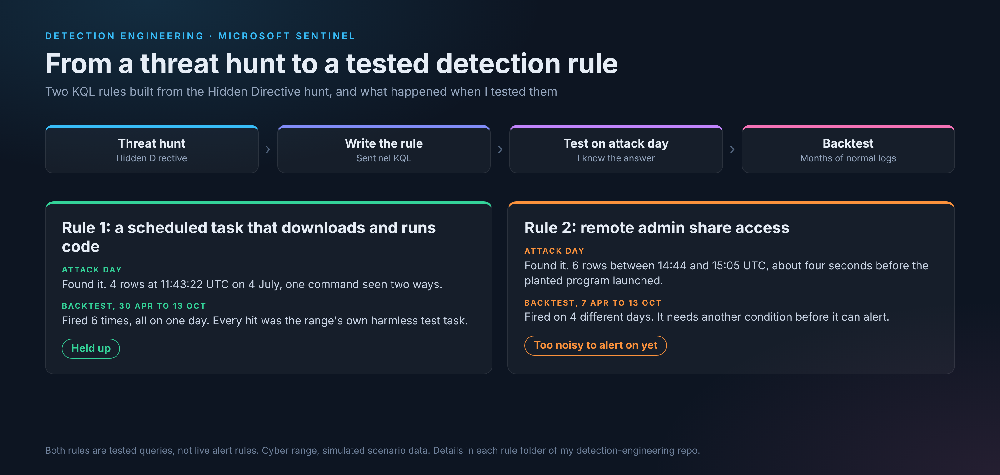

# Sentinel KQL Detection Rules

Detection rules I've written for Microsoft Sentinel and tested on the LOG(N) Pacific Cyber Range. Each rule is built from something I found in a threat hunt. Each folder has the write-up, a one-page summary, the query, and my screenshots.

_Defensive security work by Virginia Gina Nelai, performed on a cyber range (simulated scenarios)._

---

## Rules

**[Scheduled task that downloads and runs code](scheduled-task-download-persistence/README.md)**
Catches a scheduled task created to pull code from the internet and run it. Held up on five months of other logs.

**[Remote admin share access](remote-admin-share-access/README.md)**
Catches a network logon followed by admin share access on a domain controller. Caught the attack, but was too noisy on ordinary days to alert on as it's written.

Both come from my [Hidden Directive threat hunt](https://github.com/vnelai/threat-hunting-labs/tree/master/Mission_02_Hidden_Directive).

---

## How I tested them

I ran each query on the attack day, where I already knew the answer. Then I ran it over months of other logs from the same workspace to see what else it would flag. That second step is called backtesting. A noisy environment is the point of it, because a rule that only works on a quiet system isn't useful in the real world.

I didn't turn them into live scheduled rules, because I didn't want to affect the cyber range environment or the tools the leads have in place. They're tested queries, ready to be set up as rules.

---

*Cyber range exercises on simulated scenario data. No client data.*
