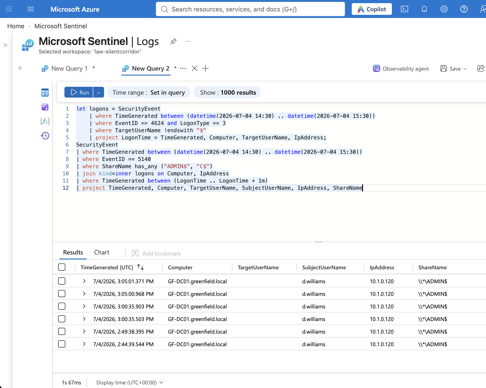

# Remote Admin Share Access on a Domain Controller

**Analyst:** Virginia Gina Nelai
**Environment:** LOG(N) Pacific Cyber Range (cyber range, simulated scenario)
**Tools:** Microsoft Sentinel, KQL
**MITRE ATT&CK:** T1021.002, T1569.002

In my [Hidden Directive threat hunt](https://github.com/vnelai/threat-hunting-labs/tree/master/Mission_02_Hidden_Directive), `d.williams` logged in over the network to GF-DC01, opened the `ADMIN$` share, and a few seconds later the attacker's program launched. This rule is built from that.

I did not turn it into a live scheduled rule in Sentinel. I didn't want to affect the cyber range environment or the tools the leads already have in place. So this is a tested query. It also isn't ready to be a live rule yet, and the quiet-day test below shows why. The query is also in [remote_admin_share_access.kql](remote_admin_share_access.kql).

```kql
let logons = SecurityEvent
    | where TimeGenerated between (datetime(2026-07-04 14:30) .. datetime(2026-07-04 15:30))
    | where EventID == 4624 and LogonType == 3
    | where TargetUserName !endswith "$"
    | project LogonTime = TimeGenerated, Computer, TargetUserName, IpAddress;
SecurityEvent
| where TimeGenerated between (datetime(2026-07-04 14:30) .. datetime(2026-07-04 15:30))
| where EventID == 5140
| where ShareName has_any ("ADMIN$", "C$")
| join kind=inner logons on Computer, IpAddress
| where TimeGenerated between (LogonTime .. LogonTime + 1m)
| project TimeGenerated, Computer, TargetUserName, SubjectUserName, IpAddress, ShareName
```

## How it works

It's two queries stuck together. The first builds a list of network logons (event 4624, type 3) by real user accounts. The second looks for admin share access (event 5140) and keeps only the ones that match a logon from the same computer and IP within one minute.

## On the attack day

It returned six rows: `d.williams` to `\\*\ADMIN$` on GF-DC01 from 10.1.0.120, between 14:44 and 15:05 UTC. The 15:00:35 hits are about four seconds before the planted program launched at 15:00:39.



Two things I noticed. The first hits are about sixteen minutes before the event my hunt report focused on. And 10.1.0.120 is the same IP as the `svc_backup` logon to GF-DC01 that I had listed as unidentified, so it may be the same machine. I haven't checked which machine owns that IP.

## On quiet days

I ran it from April 7 to October 13, skipping July 4 to 6. It was noisy. It fired on:

- May 1: `t.harris` from 10.1.0.119 to GF-WS01, 3 hits
- June 12: `d.williams` from 10.1.0.120 to GF-DC01 (45 hits) and GF-SRV01 (81 hits)
- August 6: `m.smith` from 10.1.0.120 to GF-DC01, 48 hits
- October 11: `helpdesk` from 10.1.8.10 to GF-DC01, 3 hits

Those are the same accounts and the same IP as the attack, so I can't fix the noise by trusting them. I don't know why they were opening admin shares on those days. It could be other people running the same exercise in the shared range, or normal admin work (`helpdesk` looks routine). I also checked whether the "service installed" event (4697) could tell the attack apart. It isn't logged on the attack day, so it can't.

So this rule works on the attack but is too noisy to alert on as it's written. It would need another condition.

---

*Cyber range exercise on simulated scenario data (fictional Greenfield Logistics). No client data.*
